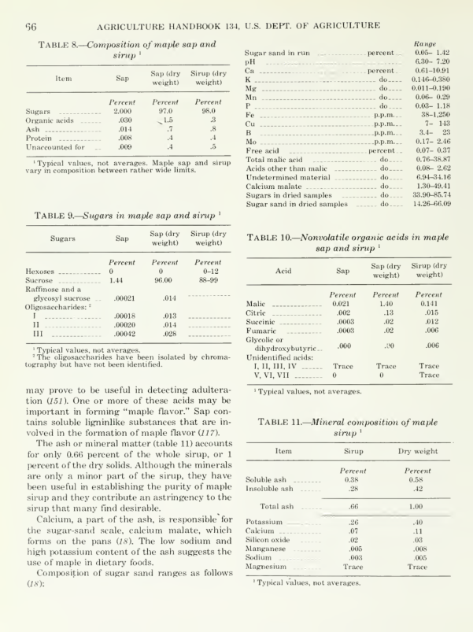
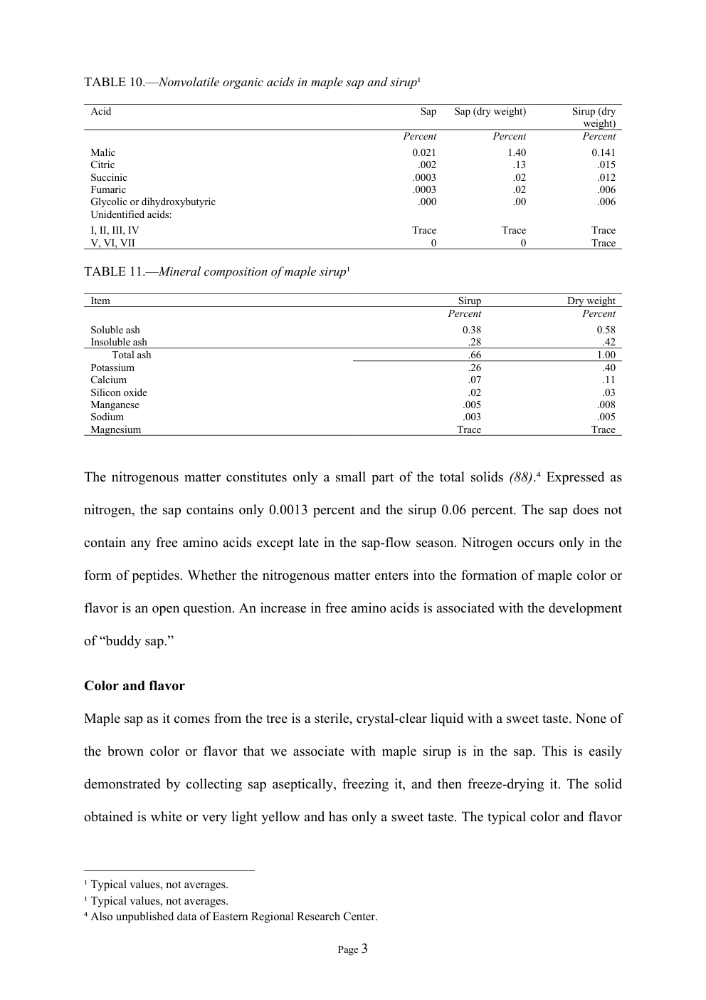
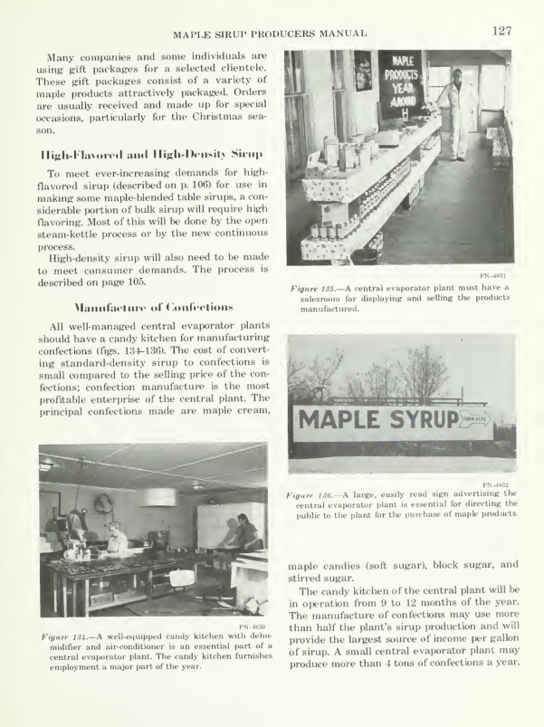
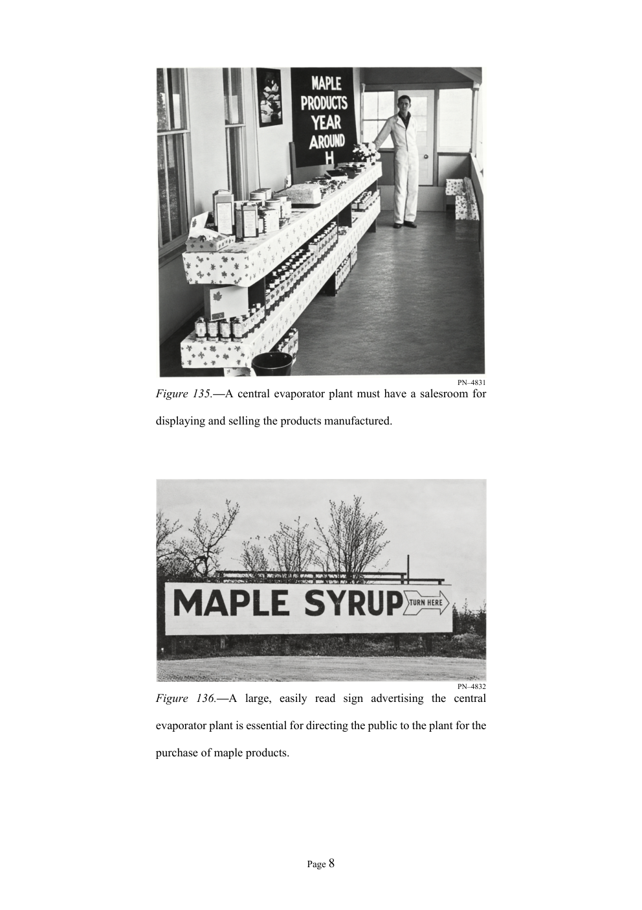

# Scanned document digitization sample

This portfolio shows selected results from converting the historical **Maple Sirup Producers Manual** into an editable Microsoft Word document and a professionally formatted PDF.

The full project used a 144-page scanned source. Its reviewed Word export contained 321 A4 pages after conversion to a single-column layout. This repository contains representative excerpts from that work.

## Download the samples

| File | Contents |
| --- | --- |
| [Original scan sample](original_scan_sample.pdf) | Five unchanged source pages, including tables, a chemical diagram, and photographs. |
| [Editable Word sample](Maple_Sirup_Sample.docx) | Selected text, editable tables, six real Word footnotes, a chart, and two photographs with captions. |
| [Formatted PDF sample](Maple_Sirup_Sample.pdf) | Eight pages exported directly from the sample Word document using Microsoft Word. |

## What the sample demonstrates

- Editable text and table cells, with source values and historical terminology retained.
- Tables 8–11, including the indented total-ash row in Table 11, plus the sugar-sand composition table.
- Chart 14 and Figures 135–136, preserved as embedded images with editable captions.
- A4 portrait pages, Times New Roman body text, justified paragraphs, smaller captions, and page numbers.
- Source comparison and manual correction after AI-assisted transcription.

## Before and after

### Numerical tables

| Original printed page 66 | Converted sample page 3 |
| --- | --- |
|  |  |

### Photographs and captions

| Original printed page 127 | Converted sample page 8 |
| --- | --- |
|  |  |

## Page mapping

| Selected content | Original PDF pages | Original printed pages | Full converted PDF pages | Sample PDF pages |
| --- | --- | --- | --- | --- |
| Maple sirup, composition, color and flavor | 71–74 | 65–68 | 159–165 | 1–7 |
| Figures 135–136 | 133 | 127 | 300 | 8 |

The original pages remain intact and include neighboring sections at the excerpt boundaries. The Word sample contains the complete selected sections and the two photograph captions. Its page numbering restarts at 1; historical table, chart, figure, and citation numbers remain unchanged.

## Preparation and review

The workflow combined AI-assisted transcription, editable Word formatting, restoration of visual material, and manual review against the scans. These excerpts preserve the corrections made in the finished Word document. Sample body text and footnote text were checked against that document, and the Word rendering and exported PDF were visually reviewed before publication.

## Source attribution

**C. O. Willits and Claude H. Hills. Maple Sirup Producers Manual.** Agriculture Handbook No. 134, Agricultural Research Service, United States Department of Agriculture, slightly revised July 1976.

Digitized source: [Internet Archive](https://archive.org/details/maplesirupproduc00willrich). Bibliographic record: [Biodiversity Heritage Library](https://www.biodiversitylibrary.org/bibliography/32706).

The historical publication is the source material; this portfolio presents the transcription and document-formatting work. Only document samples, preview images, and this README are included.
